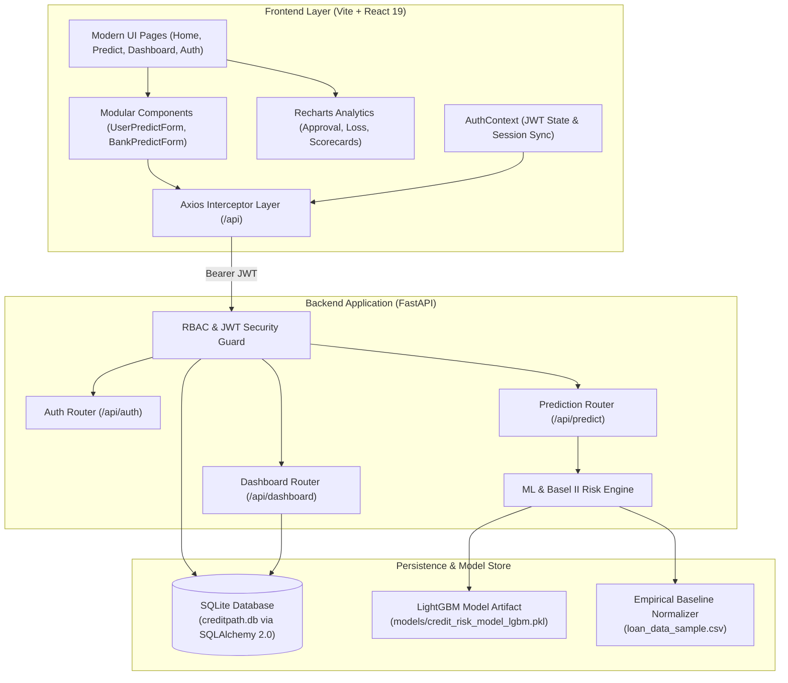

# CreditPath AI

[](https://fastapi.tiangolo.com)
[](https://react.dev)
[](https://lightgbm.readthedocs.io/)
[](https://www.sqlalchemy.org/)
[](https://opensource.org/licenses/MIT)
[-brightgreen.svg)]()

**CreditPath AI** is an enterprise-grade Loan Risk Assessment, Underwriting Intelligence, and Decision Support Platform designed for both retail borrowers and institutional credit analysts. Powered by a LightGBM gradient-boosted decision engine, Basel II Expected Loss quantification, Explainable AI (XAI) feature factor scoring, and a role-based reactive dashboard.

---

## Table of Contents
- [Architecture & System Design](#-architecture--system-design)
- [Key Features](#-key-features)
  - [1. Borrower Portal (Retail Experience)](#1-borrower-portal-retail-experience)
  - [2. Institutional Underwriting (Bank & Risk Officers)](#2-institutional-underwriting-bank--risk-officers)
  - [3. System Administration & Auditing](#3-system-administration--auditing)
- [Risk Scoring & Mathematical Methodology](#-risk-scoring--mathematical-methodology)
- [Enterprise Security & RBAC](#-enterprise-security--rbac)
- [Tech Stack](#-tech-stack)
- [Project Directory Structure](#-project-directory-structure)
- [Getting Started](#-getting-started)
  - [Prerequisites](#prerequisites)
  - [1. Backend Setup (FastAPI & SQLite)](#1-backend-setup-fastapi--sqlite)
  - [2. Frontend Setup (React 19 & Vite)](#2-frontend-setup-react-19--vite)
- [Demo Credentials](#-demo-credentials)
- [Automated Testing Suite](#-automated-testing-suite)
- [API Reference](#-api-reference)
- [License](#-license)

---

## Architecture & System Design



---

## Key Features

### 1. Borrower Portal (Retail Experience)
- **Multi-Factor Risk Assessment**: Evaluates credit score, annual income, loan amount requested, debt-to-income (DTI), and missed payment records.
- **Explainable AI (XAI) Attribution**: Transparent positive and negative factor impacts (e.g., *Strong income coverage (+15%)*, *Low credit score (-30%)*).
- **Actionable Optimization Advice**: Dynamic calculation of required monthly debt reduction to achieve healthy benchmark DTI (<30%).
- **Interactive Visualizations**: Real-time Recharts visualizations showing approval likelihood, credit score benchmarks, and financial coverage.
- **Personal Financial Goal Tracking**: Set, track, and monitor savings targets (e.g., *Home Downpayment*, *Vehicle Purchase*).

### 2. Institutional Underwriting (Bank & Risk Officers)
- **LightGBM Gradient-Boosted Scoring**: Computes calibrated Probability of Default (PD) normalized against empirical training distributions.
- **Basel II Expected Loss Quantification**: Quantifies capital risk at exposure:
  $$\text{Expected Loss (EL)} = \text{PD} \times \text{Loan Amount} \times \text{LGD}$$
- **Institutional Decisioning Matrix**:
  - **Approved** ($PD < 30\%$): Low monitoring priority; automated email and SMS communication.
  - **Conditionally Approved** ($30\% \le PD < 60\%$): Medium priority; phone follow-up and income verification.
  - **Rejected / High Risk** ($PD \ge 60\%$): High priority; field investigation and legal notice triggers.
- **Credit Risk Scorecard**: Real-time breakdown of Value at Risk (VaR), LTV thresholds, and debt capacity.

### 3. System Administration & Auditing
- **Centralized Metrics**: Aggregate counts of total registered users, overall prediction volumes, high-risk flags, and user role distributions.
- **Complete Audit Trail**: Immutable logs of all borrower and bank risk predictions.
- **Hardened CSV Export**: Formula-injection protected reporting (CWE-1236 mitigation) safeguarding spreadsheet viewers against malicious command payloads.

---

## Risk Scoring & Mathematical Methodology

### 1. LightGBM Probability Normalization
The machine learning model (`credit_risk_model_lgbm.pkl`) was trained on 36 z-score normalized risk features. The inference service uses empirical dataset statistics $(\mu, \sigma)$ from `loan_data_sample.csv` to map raw production inputs into standardized feature space before evaluation:
$$z_i = \frac{x_i - \mu_i}{\sigma_i}$$

### 2. Basel II Expected Loss Framework
Expected loss is calculated in accordance with Basel II regulatory guidelines:
$$\text{Expected Loss} = \text{PD} \times \text{EAD} \times \text{LGD}$$
- $\text{PD}$ = Probability of Default (derived from LightGBM).
- $\text{EAD}$ = Exposure at Default (requested principal loan amount).
- $\text{LGD}$ = Loss Given Default (standardized institutional benchmark of $45\%$).

---

## Enterprise Security & RBAC

| Security Control | Implementation Standard |
| :--- | :--- |
| **Authentication** | OAuth2 Password Bearer Flow with signed JSON Web Tokens (PyJWT). |
| **Password Storage** | Cryptographic hashing via `bcrypt` with salt rounds (no plaintext credentials). |
| **Authorization** | Strict Role-Based Access Control (`BORROWER`, `BANK_AGENT`, `ADMIN`). |
| **CORS Policy** | Whitelisted origin checking (`http://localhost:5173`, `http://localhost:3000`). |
| **CWE-1236 Defense** | CSV injection prevention stripping formula control characters (`=`, `+`, `-`, `@`, `\t`, `\r`). |
| **API Boundary Validation** | Pydantic v2 schemas enforcing type constraints, range limits, and regex email validation. |

---

## Tech Stack

- **Backend**: Python 3.10+, FastAPI, SQLAlchemy 2.0, Pydantic v2, PyJWT, Bcrypt, LightGBM, Scikit-learn, Pandas, NumPy.
- **Frontend**: React 19, Vite, Recharts, Axios, React Router v7.
- **Database**: SQLite (`creditpath.db`) with relational schema and connection pooling.
- **Testing**: Pytest, HTTPX, Vitest, React Testing Library, JSDOM.

---

## Project Directory Structure

```
CreditPathAI/
├── backend/
│   ├── auth/                    # Cryptography, JWT tokens & authentication routes
│   │   ├── routes.py
│   │   └── security.py
│   ├── models/                  # SQLAlchemy ORM declarative models
│   │   └── db_models.py
│   ├── routes/                  # Modular endpoint routers
│   │   ├── dashboard.py
│   │   └── predict.py
│   ├── services/                # ML inference & Basel II risk scoring
│   │   └── ml_engine.py
│   ├── tests/                   # Backend automated test suite (Pytest)
│   │   ├── conftest.py
│   │   ├── test_auth.py
│   │   ├── test_dashboard.py
│   │   └── test_predict.py
│   ├── app.py                   # FastAPI application factory & startup lifecycle
│   ├── database.py              # SQLite engine & session management
│   ├── pytest.ini               # Test configuration
│   └── requirements.txt         # Pinned Python dependencies
├── frontend/
│   ├── src/
│   │   ├── api/                 # Centralized Axios client & JWT interceptors
│   │   │   └── client.js
│   │   ├── components/          # Modular UI components
│   │   │   ├── predict/         # Predict forms, scorecards & Recharts
│   │   │   │   ├── BankPredictForm.jsx
│   │   │   │   ├── RiskCharts.jsx
│   │   │   │   ├── RiskScorecard.jsx
│   │   │   │   └── UserPredictForm.jsx
│   │   │   ├── Chatbot.jsx      # Financial assistant
│   │   │   ├── Navbar.jsx       # Responsive navigation & role indicators
│   │   │   └── ProtectedRoute.jsx # Client-side route authorization guard
│   │   ├── context/             # Authentication context & persistent session
│   │   │   └── AuthContext.jsx
│   │   ├── pages/               # Top-level view routes
│   │   │   ├── About.jsx
│   │   │   ├── Auth.jsx
│   │   │   ├── Contact.jsx
│   │   │   ├── Dashboard.jsx
│   │   │   ├── Home.jsx
│   │   │   └── Predict.jsx
│   │   ├── tests/               # Frontend Vitest suite
│   │   │   ├── Auth.test.jsx
│   │   │   └── Predict.test.jsx
│   │   ├── App.jsx              # Router declaration
│   │   └── index.jsx            # React root mount
│   ├── index.html               # Vite HTML entry point
│   ├── package.json             # Pinned frontend dependencies
│   └── vite.config.js           # Vite development and proxy config
├── models/
│   └── credit_risk_model_lgbm.pkl # LightGBM trained classifier
├── loan_data_sample.csv         # Empirical reference dataset for normalization
├── LICENSE                      # MIT License
└── README.md                    # Project documentation
```

---

## Getting Started

### Prerequisites
- **Python**: Version `3.10` or higher (`3.11`, `3.12`, `3.13`, `3.14` supported).
- **Node.js**: Version `18.0.0` or higher (`20+` recommended).
- **Git**

---

### 1. Backend Setup (FastAPI & SQLite)

```bash
# Navigate to the backend directory
cd CreditPathAI/backend

# Create a virtual environment
python3 -m venv .venv

# Activate the virtual environment
# On macOS / Linux:
source .venv/bin/activate
# On Windows:
# .venv\Scripts\activate

# Install dependencies
pip install -r requirements.txt

# Start the development server
uvicorn app:app --reload --port 8000
```

The API server will launch at:
- **API URL**: `http://127.0.0.1:8000`
- **Interactive Swagger Docs**: `http://127.0.0.1:8000/docs`
- **ReDoc Documentation**: `http://127.0.0.1:8000/redoc`

*(Note: SQLite database `creditpath.db` and initial demo accounts will be created automatically on startup).*

---

### 2. Frontend Setup (React 19 & Vite)

```bash
# Open a new terminal and navigate to the frontend directory
cd CreditPathAI/frontend

# Install dependencies
npm install

# Start the Vite development server
npm run dev
```

The frontend application will be available at:
- **Web Application**: `http://localhost:5173` (or `http://localhost:3000`)

---

## Demo Credentials

The backend automatically seeds three role-specific accounts on first launch for immediate testing:

| Role | Email | Password | Access Privileges |
| :--- | :--- | :--- | :--- |
| **System Administrator** | `admin@creditpath.ai` | `CreditPath@2026` | Full platform control, System metrics, All prediction records, User management, CSV export. |
| **Bank Risk Officer** | `agent@creditpath.ai` | `CreditPath@2026` | Institutional Underwriting (`/predict/bank`), Underwriting history, Basel II analysis. |
| **Retail Borrower** | `borrower@creditpath.ai` | `CreditPath@2026` | Borrower Risk Prediction (`/predict/user`), Personal Financial Goals, Borrower history. |

*(Quick-fill buttons for these accounts are available directly on the login screen).*

---

## Automated Testing Suite

CreditPath AI includes automated test suites covering backend endpoints, authentication, authorization, Basel II mathematical boundaries, formula injection mitigation, and frontend UI components.

### 1. Run Backend Tests (Pytest)
```bash
cd CreditPathAI/backend
source .venv/bin/activate
pytest tests/ -v
```
**Test Coverage Includes:**
- User registration, duplicate email rejection, bcrypt verification, JWT lifetime validation.
- Anonymous and authenticated prediction persistence.
- Role-based authorization boundaries (Borrower attempting to access Bank Underwriting returns `403 Forbidden`).
- LightGBM probability outputs $[0, 1]$ and Basel II Expected Loss ($EL = PD \times EAD \times 0.45$).
- Financial goals CRUD operations and owner-isolation enforcement.
- Admin metrics aggregation and CSV formula injection neutralization (`=SUM...` escaped).

### 2. Run Frontend Tests (Vitest)
```bash
cd CreditPathAI/frontend
npm test
```
**Test Coverage Includes:**
- Authentication form rendering, tab switching, and one-click demo pill population.
- Token storage in `localStorage` and authenticated session dispatch.
- Borrower and Bank input form rendering and real-time input validation constraints.
- Risk scorecard, XAI factor rendering, and Recharts rendering verification.

---

## API Reference

Interactive API documentation with request schemas and execution sandboxes is available at `http://127.0.0.1:8000/docs`.

### Primary Endpoints Overview

| Method | Endpoint | Access | Description |
| :--- | :--- | :--- | :--- |
| `POST` | `/api/auth/register` | Public | Register new user account with hashed password and role. |
| `POST` | `/api/auth/login` | Public | Authenticate user and receive signed JWT bearer token. |
| `GET` | `/api/auth/me` | Authenticated | Retrieve profile details of authenticated user. |
| `POST` | `/api/predict/user` | Public / Auth | Compute borrower risk profile, XAI factors, and DTI advice. |
| `POST` | `/api/predict/bank` | Bank / Admin | Execute institutional underwriting, PD score, and Basel II expected loss. |
| `GET` | `/api/dashboard/history` | Authenticated | Retrieve user-specific historical prediction records. |
| `DELETE` | `/api/dashboard/history` | Authenticated | Clear user prediction history. |
| `GET` | `/api/dashboard/goals` | Authenticated | Retrieve personal savings and loan repayment goals. |
| `POST` | `/api/dashboard/goals` | Authenticated | Add a new financial goal. |
| `DELETE`| `/api/dashboard/goals/{id}`| Authenticated | Remove an existing financial goal. |
| `GET` | `/api/admin/metrics` | Admin Only | System-wide aggregates (prediction totals, risk distribution). |
| `GET` | `/api/admin/users` | Admin Only | List all registered user accounts and roles. |
| `GET` | `/api/admin/history` | Admin Only | Retrieve global prediction audit history. |
| `GET` | `/api/admin/export-csv` | Admin Only | Download sanitized CSV audit report with formula injection defense. |

---

## License
This project is licensed under the [MIT License](LICENSE).
